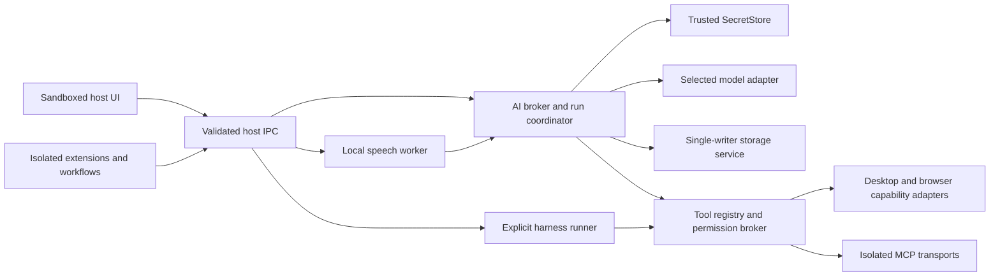

# AI, tools, harnesses, and speech architecture

Status: implementation contract for the approved 22 October 2026 plan. This specifies Linuxcast behavior; research observations are in [Raycast research](../research/raycast.md). Follow [DESIGN.md](../design/DESIGN.md) for every screen and interaction, [security](security.md) for permissions/isolation, [data](data.md) for persistence, and the [roadmap](../implementation/ROADMAP.md) for task ownership.

## Non-negotiable decisions

1. Ordinary Linuxcast AI has **one active global provider and one active global model**. There are no per-chat, per-agent, per-command, per-plugin, per-workflow or per-feature model overrides in v1. Future routing may be added through a versioned policy, never through hidden fields.
2. Every inference run snapshots that selection and its revision before it starts. Settings changes affect the next run. Continuing a chat is a new run, with the current selection shown; an in-flight run cannot silently switch endpoints, models, identities or billing.
3. OpenRouter is mandatory. Other first-class adapters cover OpenAI Responses, Anthropic Messages, Gemini, Ollama and validated compatible endpoints. Subscription and harness integrations use only documented supported routes.
4. Local storage, local workflow execution and local Whisper transcription do not require an AI account. Optional cleanup, semantic lookup, summaries and memory generation use the same global text-model broker.
5. Credentials remain in the trusted host/broker. Renderer windows, ordinary extensions, workflow packages, debug logs and exported configuration receive opaque references or redacted status, never provider keys or refresh tokens.
6. Tools and harnesses do not bypass Linuxcast permission policy. A provider's tool-call format, a skill file, an MCP annotation or model-generated instruction cannot grant authority.
7. No automatic cross-provider/model fallback, private API impersonation, CLI credential harvesting, undisclosed hosted processing, or assumed consumer-subscription API access.

## Components and trust boundaries



The broker runs outside renderer execution. Keep the main process small: authenticate IPC senders, validate requests, route them to the AI utility process/service and mediate secrets through the shared trusted SecretStore. The exact process split follows [overview](overview.md); do not create a second uncontrolled database writer or an independent provider-specific secret backend. Keep streaming parsing, network/SDK work and context construction off the UI thread. Bounded queues and backpressure are required.

The model adapter translates Linuxcast's request/event contract into one provider protocol. It never decides which provider to use. The tool registry owns effectful operation identity, schemas, provenance and capability requirements. The permission broker evaluates grants and user decisions; the scheduler invokes the same coordinator rather than a separate privileged execution route. The harness runner is a distinct integration for provider-owned agent runtimes and exposes a clear command, runtime/model identity and billing source.

## Contract to freeze before parallel implementation

The following is a normative type sketch, not application code or a package API already shipped. The foundation task must publish versioned schemas and fixture events matching these semantics.

```ts
type AiPurpose =
  | "chat" | "quick-ai" | "saved-command" | "workflow" | "extension"
  | "translation" | "emoji-assist" | "context-summary" | "memory"
  | "dictation-cleanup";

interface AiSelection {
  revision: number;
  providerProfileId: string;
  modelId: string;
}

interface ModelCapabilities {
  text: boolean;
  imageInput: boolean;
  fileInputMimeTypes: string[];
  toolCalls: boolean;
  structuredOutput: "none" | "json" | "json-schema";
  reasoningControls: string[];
  contextTokens: number | null;
  outputTokens: number | null;
  tokenUsage: "reported" | "estimated" | "unavailable";
  cancellation: "upstream" | "local-only";
}

interface AiRequest {
  runId: string;
  purpose: AiPurpose;
  origin: { kind: "builtin" | "extension" | "workflow"; id: string };
  conversationId?: string;
  selection: AiSelection; // filled by host, not accepted from untrusted IPC
  messages: NormalizedMessage[];
  context: ContextReference[];
  offeredToolIds: string[];
  outputSchema?: VersionedJsonSchema;
  limits: { timeoutMs: number; toolSteps: number; outputBytes: number };
}

interface ModelProvider {
  validateConfiguration(): Promise<ProviderStatus>;
  listModels(signal: AbortSignal): Promise<ModelCatalog>;
  stream(request: AiRequest, signal: AbortSignal): AsyncIterable<AiEvent>;
}

interface AgentHarness {
  inspect(): Promise<HarnessStatus>;
  start(request: HarnessRequest): Promise<HarnessSession>;
  resume(reference: HarnessSessionRef): Promise<HarnessSession>;
  cancel(sessionId: string): Promise<void>;
}
```

`NormalizedMessage`, `AiEvent`, `ContextReference`, `HarnessRequest` and storage records must be concrete schema definitions in the contracts task. Do not leave adapter authors to invent incompatible versions. Required message parts: text, image/file reference, tool call, tool result and supported provider reasoning metadata. A reasoning display shows only what the provider intentionally returns; it must not claim to expose hidden internal reasoning.

Required event variants: run started; text delta; reasoning/status delta when supported; tool-call argument fragment; complete validated tool request; usage; citation/source; terminal completed; terminal cancelled; terminal failed. Every event includes run ID, monotonically increasing sequence and schema version. Terminal events are mutually exclusive and persisted once. Tools cannot execute from a partial JSON fragment. Event sequence gaps, unknown variants and malformed UTF-8 must fail or be safely buffered according to the protocol; no silent coercion into success.

Provider metadata declares auth mode, normalized capabilities, catalog fetch time and provenance, endpoint, stable model ID and display name. Unknown limits stay unknown. Capabilities come from provider metadata plus adapter conformance fixtures; an “OpenAI-compatible” label cannot set every flag true. Before sending, validate all attachments, requested tools and structured output against the selected model. Unsupported requests give an actionable message and preserve the draft, not silently discard input.

The UI presents one active configuration: provider, authentication mode, model, connection status, endpoint and data destination. A saved profile abstraction may support later account management, but only one active selection is executable by ordinary AI in v1. Imported native agents/commands/workflows with legacy or future override fields must reject or explicitly strip those fields in a preview, never activate them.

## Provider and plan routes

Evidence below was checked against official pages on 22 October 2026. These are integration decisions, not a guarantee that a particular account is eligible or that terms will remain unchanged. Pin SDK/runtime versions and recheck the linked primary documentation before shipping authentication.

| Route | Authentication and billing | Implementation disposition |
| --- | --- | --- |
| [OpenRouter](https://openrouter.ai/docs/quickstart) | User API key; direct OpenRouter billing; catalog and chat-completions API. | Required first adapter. Discover exact IDs, support streaming/tools/vision according to catalog and tested serializer. Its upstream provider routing is distinct from selecting another Linuxcast model. |
| [OpenAI API](https://platform.openai.com/docs/api-reference/responses) | User OpenAI API credentials; API billing separate from consumer ChatGPT identity. | Native Responses serializer. Model discovery, tools and stream lifecycle use documented endpoints; do not reuse a subscription serializer indiscriminately. |
| [Sign in with ChatGPT](https://developers.openai.com/siwc/quickstart) | Official plan-backed authorization for eligible accounts/apps; explicit inference permission beyond identity login. | Implement the open-source dynamic-client route applicable to the GPL app, with eligibility and scope gates. Distinct auth mode and capability profile. |
| [Codex app-server](https://learn.chatgpt.com/docs/app-server) | Provider-owned runtime with supported account authentication or documented SIWC configuration. | Explicit coding-agent harness. Use version-pinned stdio protocol, lifecycle and approvals; not a generic proxy for every Linuxcast prompt. |
| [Anthropic API / Agent SDK](https://code.claude.com/docs/en/agent-sdk/overview) | User API key, or supported cloud-platform credentials, billed under that route. | Native Messages provider plus an optional Claude Agent SDK harness. Do not offer arbitrary claude.ai consumer OAuth as a third-party API credential. |
| [Unmodified Claude Code](https://code.claude.com/docs/en/legal-and-compliance) | Original CLI retains its own authentication and end-user billing. | An optional unchanged CLI launch/bundling integration must preserve provider auth and applicable terms. Never extract its credentials or replace it with a subscription API proxy. Review packaging/branding terms at the release gate. |
| [GitHub Copilot SDK](https://docs.github.com/en/copilot/how-tos/copilot-sdk/auth/authenticate) | Documented signed-in-user/CLI or OAuth integration, eligible Copilot plan; SDK also documents BYOK. | Optional explicit agent harness. Show selected identity and model/runtime, control inherited environment, and use documented credential types. It is not a universal free text-model backend. |
| [Gemini API](https://ai.google.dev/gemini-api/docs/api-key) | API key or supported cloud credentials with the applicable billing arrangement. | First-class native provider. Google AI Pro/Ultra or a CLI login is not assumed to be an API key. |
| [Gemini CLI](https://geminicli.com/docs/resources/faq/) | CLI-owned auth has its own usage terms; official FAQ disallows third-party harvesting/piggybacking of its OAuth. | API/Vertex paths for third-party integration. Original external CLI may be launched without credential interception, but no unsupported plan-backed proxy in Linuxcast. Headless JSON existing does not itself grant authorization. |
| [Ollama](https://docs.ollama.com/api/openai-compatibility) | Local service normally has no API credential; remote/cloud services are different endpoints/auth modes. | First-class local adapter, discovery and explicit lifecycle controls. Do not expose a local service to the network. Verify actual supported API subset. |
| [Groq](https://console.groq.com/docs/openai), [Together](https://docs.together.ai/docs/inference/openai-compatibility), [DeepSeek](https://api-docs.deepseek.com/), [Mistral](https://docs.mistral.ai/studio) | Individual API accounts/keys and their own billing. | Compatible-endpoint presets with provider-specific validation and capability tests. No hardcoded recommendation or equivalence claim. |
| Azure, Bedrock, Vertex and supported enterprise gateways | Cloud identity/API credentials; organization billing and policy. | Architectural extension points. Enterprise credential flows need dedicated adapters and testing; they are not consumer-plan reuse. |

OpenRouter setup must show the final normalized endpoint, verify the key without logging it, fetch models and require an explicit model selection. [Authentication](https://openrouter.ai/docs/api_reference/authentication) and [upstream provider routing](https://openrouter.ai/docs/guides/routing/provider-selection) have separate semantics: retries within the selected service may follow its declared policy, but Linuxcast must never change the selected model or billing route invisibly.

### Official ChatGPT sign-in implementation

Follow the current [open-source sign-in specification](https://developers.openai.com/siwc/token-sharing-open-source/sign-in). Use the documented dynamic bootstrap client, a stable per-installation host identifier, the real Linuxcast app name, S256 PKCE, state and nonce. Bind a temporary loopback listener to `127.0.0.1` only, with the exact redirect URI for that authorization attempt. Store and subsequently use the issued client ID as directed; initial bootstrap and registered client are not interchangeable.

Identity scopes and `chatgpt.tokens.use.direct` authorization are separate. Verify the returned identity and granted permission. “Signed in” must not become “ready for inference” until the required permission and account eligibility are established. The flow includes the documented `resource.invoke`/resource requirements; copy exact values from pinned official documentation into fixtures rather than inventing scope aliases.

Use public [models and inference endpoints](https://developers.openai.com/siwc/token-sharing-open-source/models-and-inference): the account's eligible model catalog and `/v1/responses`, with `store: false`, streaming and explicit history. No `backend-api` endpoints or browser-session scraping. The [preview limitations](https://developers.openai.com/siwc/token-sharing-open-source/preview-limitations) require a dedicated serializer: general Responses fields and hosted tools are not all supported. Audio/transcription and hosted image generation/search/execution cannot be assumed. Only the provider's completed terminal state is success.

Follow [profile/session rules](https://developers.openai.com/siwc/token-sharing-open-source/profiles-and-sessions): serialize refresh rotation per session, isolate registrations, store secrets securely, revoke renewable access on sign-out and clear local state even if revocation cannot be confirmed. [Errors and recovery](https://developers.openai.com/siwc/token-sharing-open-source/errors-and-recovery) distinguish eligibility, usage limits and service unavailability. Never offer a silent billed fallback; show the current status and preserve work.

The official [Codex app-server SIWC recipe](https://developers.openai.com/siwc/token-sharing-open-source/codex-app-server) documents a child-process configuration using public Responses and an environment credential. Keep that environment restricted to the child and out of command-line arguments/logs. Where credentials are read only at startup, refresh requires process restart and documented session resume. A cached harness model list is not proof of account entitlement.

### Harness contract and release gates

Use app-server for long-lived product integration when its documented lifecycle is required; bounded CLI jobs are a different route. The official [Codex platform overview](https://developers.openai.com/blog/codex-as-a-platform) distinguishes CLI/SDK/app-server uses. Pin the binary and generated schemas, initialize client identity correctly, and use stdio pipes rather than an open local server. The app-server's documented JSONL protocol differs from generic assumptions about JSON-RPC headers; obey its actual schema.

Harness sessions expose launch/resume/turn/cancel, progress/tool approval, terminal status and reconnectability. Handle missing executable, unsupported version, authentication required, account mismatch, quota, child crash and lost session separately. Do not parse colored terminal prose when a supported structured protocol exists. A command must display that it is handing work to a separate runtime; it must not silently substitute a harness when the global model fails.

Claude integration must distinguish two contracts. The [Agent SDK quickstart](https://code.claude.com/docs/en/agent-sdk/quickstart) supports user API/cloud credentials and bundled runtime dependencies. Its [overview](https://code.claude.com/docs/en/agent-sdk/overview) does not authorize third-party consumer login without approval. The [legal page](https://code.claude.com/docs/en/legal-and-compliance) separately discusses unchanged Claude Code in products with provider-owned authentication. These are not interchangeable permissions. Release review must document which path ships, branding, license/dependency notices and credential ownership.

Copilot's [SDK authentication](https://docs.github.com/en/copilot/how-tos/copilot-sdk/auth/authenticate), [BYOK](https://docs.github.com/en/copilot/how-tos/copilot-sdk/auth/byok) and [setup](https://docs.github.com/en/copilot/how-tos/copilot-sdk/setup) define its supported routes. Use explicit user identity selection rather than accidentally inheriting ambient `GH_TOKEN` or other shell credentials. Classic PAT support must not be inferred from support for other token types. Entitlement and model availability are live checks, not a fixed table.

Gemini's [headless mode](https://geminicli.com/docs/cli/headless/) and [CLI quotas](https://geminicli.com/docs/resources/quota-and-pricing/) explain a CLI interface and subscription benefits; neither supersedes its OAuth restrictions. An integration must retain the distinction between an original tool using its own account and Linuxcast offering a third-party inference service.

## Authentication, transport, and secret storage

Use the shared trusted SecretStore from [security.md](security.md#secrets-and-content-privacy) and [data.md](data.md#secrets). It owns OS-keyring-backed Electron `safeStorage` encryption/decryption, private encrypted credential blobs, and opaque references stored in SQLite. AI adapters must not introduce a separate direct Secret Service implementation or their own credential files. Verify the actual secure backend on Linux. Electron's [safeStorage documentation](https://www.electronjs.org/docs/latest/api/safe-storage) identifies an insecure `basic_text` fallback; **never persist credentials using that fallback**. If secure storage is unavailable/locked or encryption validation fails, offer session-only credentials and explain why persistence is disabled. Pin Electron and use the secure API actually available in that version; do not assume documentation for a newer release matches the shipped runtime.

Redact keys, authorization headers, OAuth codes, tokens, cookies and sensitive URI parameters from telemetry, logs, exceptions and developer export. Provider profiles persist secret references, never plaintext YAML keys. Removing a provider must cancel or settle its runs according to explicit user choice, invalidate auth cache and remove its local secret. Native exports exclude secrets by default and clearly list excluded fields.

HTTPS is required for remote endpoints. Plain HTTP is allowed only for explicit loopback local services by default; remote insecure development endpoints require a conspicuous per-endpoint opt-in and cannot be normalized into a trusted provider preset. Validate redirects without forwarding credentials across origins. Proxy/custom-CA settings must be explicit and testable; do not disable TLS verification. Extension network policy remains separate from broker network access.

Retries are bounded and classified. Auth refresh may be retried once under a serialized lock; rate limits respect provider retry information. Do not replay an already visible response as if it were a continuation, and do not retry effectful tools merely because the response stream broke. Provider availability checks should be cheap and intentional, not unsolicited periodic inference.

## Chat, Quick AI, and saved-command lifecycle

Persist drafts, ordered message parts, immutable user revisions/branches, attachments, run selection snapshots, tool approvals/results and terminal states through the storage service. Minimum run states are `queued`, `preparing`, `streaming`, `awaiting-approval`, `running-tool`, `completed`, `cancelled`, `failed` and `interrupted`. A process restart converts nonterminal work to an explicitly recoverable state; it cannot mark partial text complete.

Required UI behaviors are streaming/cancel, edit and rerun with clear branch/replacement semantics, regenerate, branch from a message, history search, rename, pin, archive, trash/restore/permanent delete, project moves and Quick AI handoff. Keep source conversation history available when summarizing older turns for a context window. Summaries identify their originating range and selection; users can inspect/regenerate them. Large tool output is stored as a local artifact with a bounded excerpt, not silently dropped.

Default new input during a running turn is queued. “Steer” appears only when the active adapter/harness truly supports it; otherwise label the operation as queueing or stop-and-restart. Never call adding text to a queue real-time steering. Notification, topmost, zoom and prevent-sleep controls use desktop capabilities and user settings.

Saved commands consist of native ID, title, icon reference, tags, prompt template, argument schema, declared context sources, allowed tools and output mode. They have no credential or model fields. Output choices include result window, copy and explicit paste/replace of the captured selection. Replacement validates current focus/selection epoch and falls back to a preview if it changed. Quick Fix, translation, semantic emoji search and extension AI call this same broker; they are not separate hidden products.

Context budgeting accounts for instructions, history, attachments and offered tool schemas. Unknown token limits must show estimates as such. Do not silently omit a selected attachment to make a request fit. Offer explicit truncation, summary or removal; preserve original material locally.

## Context acquisition and data provenance

Every attachment has source kind, display name, captured time, origin app/window/site when available, local reference, MIME type, size and transmission policy. Context sources include user-selected files, selection, current clipboard item, note, browser tab/page, accessibility text, screenshot/region/window and calendar data. The context inspector shows what will be sent and permits removal before transmission.

Acquisition uses separate permissions. Screenshot portal consent, accessibility access, browser content access and selected-text acquisition cannot substitute for one another. Never scrape passwords/secure controls or automatically attach unrelated clipboard history. Capture is bound to a focus/session epoch; switching windows while a request is preparing cannot redirect a replacement or attach the wrong private app. Source unavailability must be visible.

Browser companions are optional and paired through native messaging; tab identity, URL, title and permission state travel with content. Reject unsolicited/unpaired messages, oversized payloads and stale tab replies. Page scripts and text are untrusted context, not instructions for the host. Do not infer permission to browser-click/type from permission to read a page.

The optional privileged input service supports snippets/Hyper and narrow input operations described in [Linux integration](linux-integration.md). It never exposes raw keystrokes to AI, workflows or extensions. Enabling that service does not authorize continuous screen capture, clipboard transmission or broad accessibility reads.

## Tools, MCP, agents, skills, and projects

Tool descriptors include stable namespaced ID, owner/version, input/output schemas, required capabilities, effect classification, working-directory/scope requirements, timeout and idempotency metadata. Tool execution is: validate complete arguments → resolve source/scope → evaluate policy → obtain any required approval → execute → journal result → return bounded output. Only committed tool results enter the model conversation. A denial remains a denial; the agent cannot evade it through an equivalent shell command.

Approval UI shows exact relevant arguments, target files/URLs/recipients and original shell text, with a human-readable effect explanation. Model-provided descriptions supplement rather than replace facts. “Read-only” annotations are not trusted proof. Permission grants have owner/scope/duration and a visible revocation route. Shell execution, outbound messages, destructive operations and external side effects follow the shared security policy; network tools do not receive all provider secrets.

MCP supports stdio and Streamable HTTP using a pinned official SDK. Store environment/header secrets by reference; keep transport diagnostics redacted. Expose install/configure, connect/authenticate, discover, status, logs, stop/start/restart, refresh, sign-out and uninstall. Treat server instructions, resources, prompts and tool schemas as untrusted inputs. Re-evaluate changed schemas/permissions on refresh. Local MCP processes run under the applicable isolation and resource controls, with an explicit working directory. HTTP OAuth uses the server's supported flow and exact redirect rules, not copied provider-specific assumptions.

Agents are named reusable instructions and tool scopes, with icon/tags and entry points. They inherit the global model. Dynamic tool discovery may select relevant permitted tools but cannot grant new permissions. The deep-research example must cite retrieved sources and require configured search tools rather than inventing a hosted search entitlement.

Skills support validated `SKILL.md` instructions and assets within a native Linuxcast package/directory. Index concise metadata; load full content only when selected/relevant. Set deterministic directory precedence and duplicate-name behavior, bounded file sizes, file-watch refresh, a manual refresh action and parse diagnostics. Show source and trust level. A skill's instruction to execute a script does not authorize that execution. This content support is not Raycast package compatibility or an Alfred importer.

Projects store name/icon, chats, user instructions, optional scoped working directory and optional memory. Context precedence must be explicit: host security and direct user instructions dominate imported project/skill/file content. Directory instructions can inform behavior within their scope but cannot expand permissions. Project selection does not index/upload an entire home directory. Moving a chat changes future project context with a visible notice; deleting a project offers retaining its chats separately.

Profile and memory are independent. The user can edit a static profile. Automatic global/project memory learning is off by default and needs informed opt-in. Memory items record source conversations, scope, generated/edited status and update time; allow inspect, edit, exclude, regenerate, clear and disable. Generate through the active global model and show that destination. A project's memory never leaks into unrelated projects by default. Removing source chats must offer clear memory-deletion behavior; retaining derived memory cannot be an invisible consequence.

## Durable local schedules

Schedules use the same run and permission coordinator as interactive work. Persist a native schedule ID/version, title/icon, once or recurrence expression, IANA timezone, next due instant, target chat policy, instruction, enabled state, last outcome and missed/busy policy. A schedule has no model field; resolve the active global model at each actual execution and journal the selection. Do not capture a secret or provider choice inside a task definition.

The shared [data scheduler contract](data.md#durable-scheduler-semantics) is normative: skip nonexistent spring-forward local times; execute repeated fall-back times once at the earlier occurrence. The default missed-run policy executes the latest missed occurrence once on resume/restart and marks older occurrences skipped; users may instead choose to skip all missed occurrences. Per-automation concurrency is one. Coalesce a busy target chat to at most one eligible pending run according to that policy; do not spawn an unbounded queue. An archived target is skipped with status. If its chat was deleted, follow the schedule's explicit recorded policy—default disable and require user repair; allow a user-selected “create new chat” policy. This deliberate default is safer than silently recreating deleted content.

Schedules execute while the local app/service is running and the device is awake. There is no v1 cloud execution or wake-from-suspend promise. Display missed/deferred/blocked outcomes. Tool approval pauses visibly and expires predictably; lack of user response is not permission. AI may propose a schedule, but only a user-confirmed native operation creates/edits/enables it. Scheduled agents cannot rewrite their own schedule to expand scope.

Journal planned/run/side-effect identities transactionally. If a process dies after an external action but before confirmation, record an unknown outcome and require reconciliation; exactly-once external effects cannot be guaranteed generically. Retry pure/read operations according to policy, not arbitrary effectful actions. Include DST, clock changes, suspension, deletion, busy chat and double-start races in acceptance tests.

## Local dictation and optional cleanup

Bundle the speech runtime integration, not an unannounced model download. The selected local Whisper model is an explicit downloadable asset with size, license, checksum, storage path, hardware/resource expectations and removal action. Speech model selection is separate from the single conversational AI model because transcription is a local media engine. It must not become a hidden second cloud inference provider.

Provide microphone/device selection, availability/permission status, tap-to-toggle and hold-to-record modes where supported, recording timer/waveform, cancel, stop/transcribe and progress. Establish a bounded session duration and buffer/disk cap in the media task; terminate safely on device loss, suspend, permission revocation and resource limits. Transcription works offline after model installation.

Support automatic/manual language, user vocabulary, raw transcript editing, per-app/site cleanup styles, output to current app/notes/chat and history. Cleanup using the global provider is optional; show that transcript and any chosen context will leave the machine for a remote selection. The default raw local transcript needs no provider. A style cannot override model or add unrestricted app context.

Audio retention is off by default; retain only while needed for the current operation unless the user enables history recordings. History clearly distinguishes retained audio from text, with delete/export and retention controls. Retry from audio is available only while the recording exists; do not imply recoverability after deletion. Protect history from ordinary extension access.

Pasting validates the destination/focus epoch and secure-input policy. Otherwise present copy/preview. Automatic pressing of Enter is separately opt-in per destination and disabled when focus is uncertain. Recording hotkeys use the platform/input subsystem's proven capabilities; microphone permission is independent of input capture permission.

## Parallel task boundaries and dependency order

Detailed task IDs and owners live in the [task registry](../implementation/tasks.json). These groups state interfaces and acceptance obligations; they do not replace individual cards.

| Group | Inputs/dependencies | Owned outcome | Parallelization rule |
| --- | --- | --- | --- |
| A1 providers | Frozen AI/event/secret contracts; storage service; network policy; design settings primitives | Broker, global selection, capabilities, provider settings/catalogs, adapters, keyring/session-only behavior and official auth | Protocol adapters may run independently against a shared conformance suite; one coordinator owns contract/package changes. |
| A2 chat/commands | Frozen run/message/context contracts; host components; mock A1; later real A1 | Quick AI, chat lifecycle, command authoring/output, context inspector and all implicit AI clients | UI and persistence work use deterministic mock streams. Integrate only after all terminal/error fixtures pass. |
| A3 agents/tools/harnesses | Permission/tool contracts; sandbox/runtime; platform/browser capability interfaces; A1/A2 integration | Tools, MCP, skills, agents/projects/memory, versioned harness adapters | MCP and each permitted harness can develop in separate owned paths; shared grants and tool journal remain centrally owned. |
| A4 scheduler | Durable run IDs/storage; A2 chat state; A3 approval execution; time abstraction | Native schedules, restart/DST/coalescing behavior, UI/status and recovery | Recurrence engine/UI can use fake clocks and mock runs before real agents integrate. |
| M2 dictation | Media/native worker contract; input capability API; permission/UI primitives; A1 only for optional cleanup | Local Whisper model lifecycle, recording/transcription, history/styles and guarded output | Offline media engine and UI can proceed independently from cloud providers. |

Before implementation fans out, freeze fixtures for selection snapshots, a multi-part successful stream, truncated stream, tool approval/denial, authentication refresh, capability rejection and interrupted recovery. Assign migrations through the central data owner. Each task consumes shared mocks and writes only its owned paths; no worker independently changes global provider semantics or UI tokens.

## Acceptance gates

| Gate | Required evidence |
| --- | --- |
| Global selection | Exercise chat, Quick AI, command, translation, emoji assistance, workflow, extension, memory and cleanup. Every trace uses the same selected provider/model revision; changing settings mid-stream does not reroute it. No keys in renderer/devtools fixtures or exported packages. |
| Stream correctness | Fragment UTF-8/code/tool arguments; disconnect after partial text; send malformed/duplicate terminal events; cancel before/after a tool. No partial request executes, no interrupted answer says complete, no side effect is replayed. |
| Provider conformance | Mock contract suite for every serializer plus opt-in real-account smoke evidence for release-supported adapters. Validate tool/vision/structured-output differences, unknown model, stale catalog, revoked key, 429 and unsupported parameters. No paid CI request without credentials/opt-in. |
| Secret storage | Real keyring tests on both desktops; locked/unavailable and insecure-backend fixtures yield session-only storage. OAuth secrets and provider headers do not appear in logs, crash exports, history or argv. |
| Subscription/harness | Official auth route, eligibility denial, account switch, token refresh race, revocation, quota, unsupported runtime version, child crash and resume tested. API-key and plan billing modes stay distinguishable. Terms/version evidence recorded before release. |
| Context and tools | Source preview/removal, stale focus/tab, forbidden files, secure controls, denied capture, hostile page/skill/MCP instructions and schema changes. No input-service raw events exposed to AI. Approval shows concrete targets and cannot be bypassed by equivalent tool choice. |
| Chat/data | Edit/branch/queue/restart recovery, summary provenance, oversized output, project move/isolation, trash/restore and derived-memory deletion behavior. A failed provider never destroys a draft. |
| Scheduler | Fake-clock DST tests plus real suspend/resume, multiple missed occurrences, busy/archived/deleted chat, denied approval and uncertain external-effect recovery. One pending coalesced run, never an accidental execution storm. |
| Dictation | Airplane-mode transcription, absent microphone/model, corrupted download, device loss, multilingual fixtures, long-session bounds, cancel, audio retention and changed-focus paste. Cloud cleanup opt-out produces no inference traffic. |
| Desktop/design | GNOME 48/KDE 6.3 × Wayland/X11 evidence for capture, focus, paste, notifications and recording hotkeys. Missing companions/helper remain truthful states. Light/dark, keyboard-only, screen-reader semantics and reduced motion follow DESIGN.md. |

The release report must distinguish implemented local functionality, configured external services, unavailable capabilities and untested account-specific routes. Documented provider support alone is not end-to-end evidence for the packaged Debian client.
