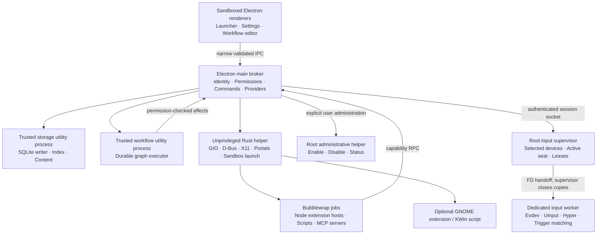

# Architecture and implementation boundaries

Status: proposed implementation contract. Research snapshot: 2026-10-22. This repository contains a plan, not a working client; source-confirmed platform APIs and required validation are distinguished throughout these documents.

Linuxcast is a GPL-3.0 desktop launcher and automation client for Debian 13. The initial release targets amd64, GNOME 48 and KDE Plasma 6.3, under both Wayland and X11. It provides Linux-native equivalents of the researched Raycast and Alfred functionality, including a visual workflow editor. It does not run or import Raycast extensions, Alfred workflows, macOS automation, or their proprietary services.

All product screens, extension views, empty states, permission prompts, onboarding and workflow editor components must follow the [design contract](../design/DESIGN.md). A platform limitation changes the available action and explanatory copy; it must not produce an unstyled secondary interface.

## Decisions that implementers must preserve

1. Ship one Debian package containing the Electron client, Rust helpers, sandboxed Node runtime and optional desktop components. System libraries remain normal Debian dependencies.
2. Keep user content local unless an explicitly invoked integration needs a configured remote service. There is no Linuxcast account or cloud synchronization in v1. CalDAV/CardDAV, optional provider requests and browser integration remain supported user-configured connections.
3. Separate trusted application services, untrusted extensions and privileged input access. Neither extensions nor Electron renderers receive device access, database credentials, arbitrary D-Bus access or root execution.
4. Implement Linuxcast-native declarative extensions and versioned workflow documents. Do not build a React custom reconciler, Raycast API shim or arbitrary browser UI extension mechanism in v1.
5. Persist ordinary content in SQLite and private files, and secrets through the OS keyring. This is not a claim that clipboard history, notes or the local database are encrypted at rest.
6. Mandatory bubblewrap isolation is required for extensions, workflow script jobs and local MCP servers. If isolation cannot start, those operations are unavailable; there is no unsandboxed fallback.
7. Treat desktop integration as a capability negotiation. A successful build or an environment variable identifying Wayland is not proof that an operation is usable.
8. Include the opt-in privileged input service needed for Hyper and automatic snippet triggers. It is installed disabled and stopped; its integration must pass the independent security and recovery gate in [Linux integration](linux-integration.md).

## Process topology



| Boundary | Owns | Must not own |
| --- | --- | --- |
| Renderer | Presentation, keyboard navigation inside Linuxcast, view state, accessible workflow graph editing | Node APIs, arbitrary filesystem/network, provider credentials, general IPC forwarding |
| Main broker | Window lifecycle, user intent, command registry, permission decisions, provider traffic, verified child lifecycles, one active scheduling coordinator | Arbitrary extension evaluation, long-running indexing or OCR on its event loop |
| Storage utility process | SQLite connection/writer, migrations, search/index data, content repositories, durable run/event records | Direct provider calls, plugin code, device access |
| Workflow utility process | Graph validation/execution, conditions, bounded transformations, cancellation and checkpoint decisions | Bypassing broker permissions, running arbitrary shell inside the trusted process |
| Unprivileged native helper | Desktop protocols, launching the prescribed sandbox profile, desktop component handshake | Root privileges, template evaluation, extension-defined D-Bus messages |
| Extension host | One installed extension's JavaScript and bounded local state | Other extensions' data, display/session bus sockets, user home, raw provider keys, raw input |
| Privileged input subsystem | Fixed device lifecycle, literal trigger recognition and fixed remapping, approved bounded input transactions | Snippet templates, workflows, provider traffic, shell, browser content, SQLite user data |

Electron utility processes are trusted isolation for responsiveness and crash containment, not an untrusted-code security boundary. Electron documents utility processes separately from renderer sandboxing; both require lifecycle handling. [Electron utility processes](https://github.com/electron/electron/blob/main/docs/api/utility-process.md), [Electron sandbox](https://www.electronjs.org/docs/latest/tutorial/sandbox).

## Workspace and ownership

Use a pnpm workspace with these ownership boundaries. The names are implementation targets, not directories already implemented.

| Directory | Responsibility | Allowed direct dependencies |
| --- | --- | --- |
| `apps/desktop/src/main` | Electron broker, app lifecycle, IPC, command routing | Contracts, domain packages, desktop adapters |
| `apps/desktop/src/preload` | Typed, minimal contextBridge API | Contracts only; no unrestricted `send`, `invoke` or listener API |
| `apps/desktop/src/renderer` | React launcher, settings, notes/calendar, editor | Contracts, design system, extension view renderer |
| `packages/contracts` | Zod schemas, inferred TS types, protocol fixtures, stable error codes | Zod only, no Electron/Node runtime dependencies |
| `packages/design-system` | Tokens and accessible shared UI | React, Tailwind; follows [DESIGN.md](../design/DESIGN.md) |
| `packages/core` | Command identity, ranking, deterministic pure domain rules | Contracts |
| `packages/storage` | SQLite repositories, SQL migrations and storage utility entry | Contracts, better-sqlite3 |
| `packages/workflow-engine` | Graph compiler, executor and checkpoint state machine | Contracts; broker effect interface |
| `packages/extension-sdk` | Native Linuxcast manifest, ViewModel and RPC client | Contracts; no Electron import |
| `packages/extension-host` | Sandboxed Node host entry and SDK transport | Contracts, SDK |
| `packages/ai` | Provider adapters, model capabilities, chat/tool orchestration | Contracts; broker network/secrets interfaces |
| `native/linuxcast-helper` | Rust desktop integration and sandbox launch | Shared native protocol crate |
| `native/linuxcast-input` | Administrative helper, supervisor and input worker | Shared native protocol crate; no content/AI dependency |
| `native/protocol` | Serde protocol types and fixture tests | Minimal Rust dependencies |
| `integrations/gnome` | GNOME 48 companion | Fixed versioned helper protocol |
| `integrations/kwin` | Plasma 6.3 script | Fixed versioned helper protocol |
| `integrations/browser` | Optional Firefox/Chromium companion and native-messaging host | Browser-specific adapter plus contracts |
| `resources` | Icons, bundled licenses, desktop files, policy/service definitions | No executable downloads at runtime |
| `tests/fixtures` | Shared contract, workflow, calendar and adversarial fixtures | No production dependency |
| `tests/native` | Real-session integration and input recovery tests | Test-only tooling |

Place pure transformations in domain packages. Keep OS-specific assumptions behind adapters. Future platforms implement the same capability and effect contracts instead of importing Linux modules into product components.

## Shared protocol contract

Before feature teams work independently, freeze version 1 of the following schemas and publish runnable fixtures. Use Zod as the TypeScript source of truth; Rust Serde models must pass the same JSON fixtures. Generated artifacts may be checked in, but there is only one semantic definition of each message.

```ts
type CapabilityState =
  | "available" | "permission-required" | "component-required"
  | "unsupported" | "temporarily-unavailable";

type CapabilityStatus = {
  id: string;
  state: CapabilityState;
  backend: string | null;
  reasonCode?: string;
  remediationAction?: string;
  generation: number;
};

type RpcRequest = {
  protocolVersion: 1;
  id: string;
  method: string;
  params: unknown; // validated against the registered method schema
  deadlineMs?: number;
};

type RpcFailure = {
  code: "invalid-request" | "permission-denied" | "capability-unavailable"
      | "cancelled" | "deadline-exceeded" | "conflict" | "internal";
  message: string; // safe to show; never raw secret-bearing stderr
  retryable: boolean;
  details?: Record<string, string | number | boolean>;
};
```

Protocol rules:

- Use JSON-RPC-style request/response IDs with length-prefixed UTF-8 JSON envelopes over child stdio; stdout is protocol-only and stderr is redacted diagnostics. Socket transports use the same bounded framing. A workflow script's documented JSON input/output format is wrapped by its host and is not the host-control transport. Do not open a localhost HTTP service for native communication.
- Maximum envelope size is 1 MiB. Reject before allocating a claimed larger frame. File/image data travels by opaque scoped blob handle, never an arbitrary caller path or unbounded base64 field.
- First message exchanges protocol version, component build/version, supported methods and capability generation. Unknown methods and mismatched major versions fail closed.
- Every asynchronous operation has cancellation, a deadline and exactly one terminal outcome. Cancellation is not proof that an external side effect was undone.
- Subscription ownership belongs to a connection. Disconnect cancels subscriptions, closes handles and expires leases. Reconnection requires a new handshake.
- Command IDs are stable namespaced strings. A command includes title, searchable aliases, source, argument schema, required capabilities, permission requirements, visibility predicate and action handler.
- Every effect carries a trusted principal (`builtin`, extension identity, workflow identity or user-approved AI tool call), grant scope, invocation ID and user-intent context. Do not trust an extension-supplied principal.
- Capability generation changes invalidate cached UI actions, input contexts and permissions dependent on the previous session. Query again after desktop service changes, portal revocation, lock/unlock or helper restart.

Initial capability IDs: `launcher.activate`, `launcher.position`, `clipboard.read`, `clipboard.monitor`, `input.paste`, `input.remap`, `input.capture`, `input.autoExpand`, `windows.list`, `windows.resize`, `screen.capture`, `secrets.persist`, `sandbox.execute`. Add distinct capabilities for future operations instead of interpreting one successful grant as blanket permission.

## Declarative extension boundary

An extension manifest declares its ID, version, minimum SDK version, commands, preferences and requested permissions. It ships bundled JavaScript and static assets. One isolated Node host is created per active extension; commands from the same extension share that host until its idle timeout. Default idle timeout is five minutes, with immediate termination on disable, removal or revoked required permissions. Background activity requires an explicit manifest capability and user grant.

The host emits a typed ViewModel with `List`, `Grid`, `Detail` and `Form` roots plus host-owned `Text`, `Image` and `Pdf` previews, stable item IDs, text, sanitized Markdown, safe image/blob references and declared actions. The trusted renderer owns layout, focus, theme and accessibility. Events return stable action IDs and validated form values. Extensions cannot submit HTML, CSS, React components, executable event handlers or renderer source. This is a Linuxcast SDK, not a compatibility promise for third-party ecosystems. Exact schemas and package limits are authoritative in [extensions.md](extensions.md).

Broker methods include scoped storage, file handles, approved network requests, application launch, clipboard operations, notifications and configured AI requests. Missing permissions produce a typed response and a native Linuxcast permission flow. Neither a prompt embedded in an extension nor an AI-generated tool request can approve itself. [Security contract](security.md).

## Workflow and automation boundary

The visual editor produces the same versioned graph that the executor consumes. Graph nodes reference stable command/node IDs and typed ports; execution must never depend on canvas coordinates. The editor supports keyboard access and a structured outline alternative. Script nodes run as separate sandbox jobs; built-in text, conditions and list operations run in the workflow worker. All effects return through the broker.

SQLite stores immutable run IDs and step transitions. The scheduler has one owner while the desktop application is resident; hiding the launcher keeps it running. Explicit Quit, logout, sleep and power-off pause execution. V1 does not claim to run during logout or wake the computer. Recovery, missed occurrences, DST and non-idempotent effects follow [data and scheduling](data.md).

Skills are instruction documents attached to explicit invocations; they do not grant capabilities. Projects group local context, conversations, tools and automations without becoming new process privileges. Local MCP servers use their own sandbox/grants; remote MCP connections use the network broker. Tool discovery does not authorize execution.

## Local feature services

- Notes, calendar/contact data, snippets, clipboard history, quicklinks, preferences and workflow definitions use versioned repositories in the storage worker.
- Local calendar events and ICS import/export work without a network connection. CalDAV/CardDAV adapters use explicit account setup, keyring credentials, bounded parsing and conflict detection.
- Screenshot/OCR uses portal capture and a bounded Tesseract worker. Dictation uses a bundled whisper.cpp runner and an optional explicitly downloaded, checksum-verified multilingual base model. Models are assets, not runtime code downloads.
- Browser integration uses native messaging with browser-extension identity checks and profile pairing. A browser extension requires separate explicit enablement; installing the `.deb` does not silently enable it.
- AI has one configured default provider and model in v1, with a capability registry. An unavailable tool/vision/audio capability is explained; do not silently switch provider, model or from local to remote processing. Provider-specific details belong in the AI plan.

## Parallel delivery and integration gates

The shared contracts, command identity, capability model, permission vocabulary, design tokens, workspace build and data migration harness form the first integration gate. Freeze those before parallel teams implement feature behavior.

After that gate, work can proceed independently on launcher/UI, storage/indexing, X11 integration, GNOME component, KWin component, extension sandbox/SDK, workflow executor, visual editor, local content tools, provider integration and Debian packaging. Each team implements against a fake counterpart and shared fixtures. The native input service is a separate security-critical workstream; its release gate must pass before automatic snippets and Hyper are enabled in a release build.

Every feature is complete only when its domain tests, contract fixtures, design review, permission/unsupported states and relevant real-desktop tests pass. A mock portal or Xvfb test does not substitute for GNOME/KDE Wayland validation. A runtime integration that fails its gate remains unavailable and keeps the release checklist open; do not quietly redefine v1 scope.

Proposed performance acceptance targets, to be measured on a documented Debian reference VM and an actual desktop: warm launcher visible within 100 ms p95; indexed search response within 50 ms p95 for 100,000 indexed paths; cancellable user jobs respond to cancellation within one second. These are targets, not measured results. Report dataset, hardware, sample count and cold/warm distinction with measurements.

## Reading map

- [Stack and release policy](stack.md): selected libraries, build/package layout, version handling.
- [Linux integration](linux-integration.md): desktop capability matrix and complete input-service contract.
- [Security](security.md): trust boundaries, permissions, sandbox and adversarial tests.
- [Data](data.md): schema ownership, retention, migration, export and scheduler recovery.
- [Design](../design/DESIGN.md): required visual and interaction contract.
