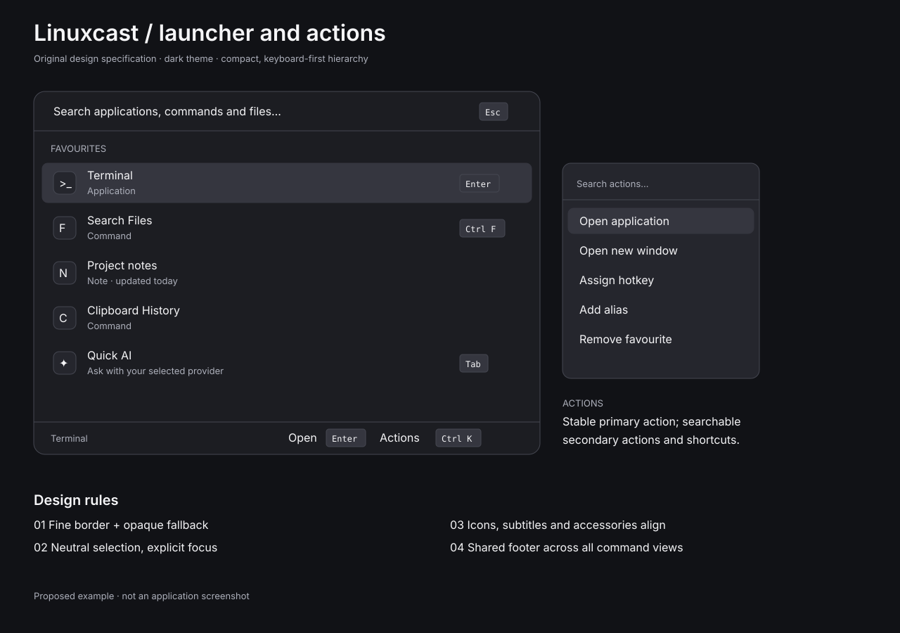
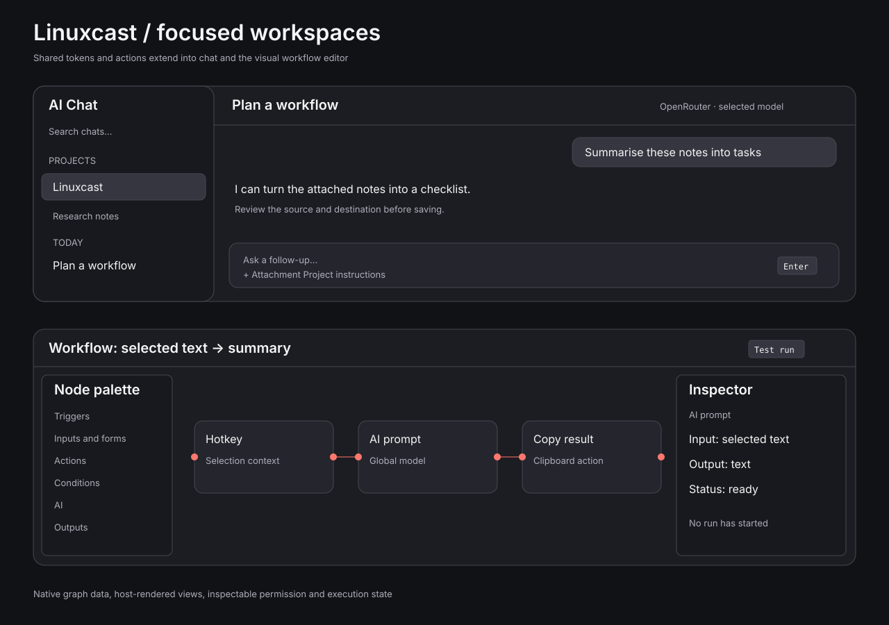
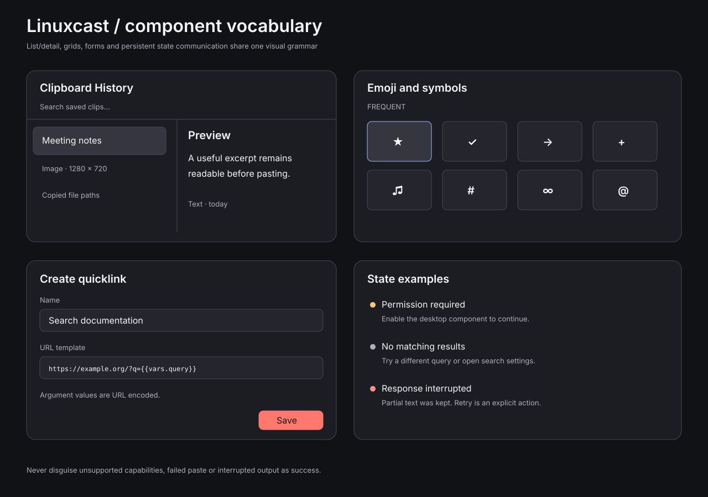
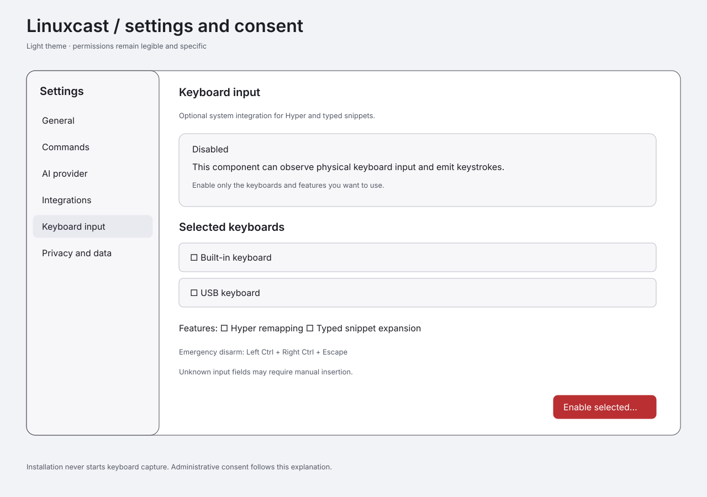
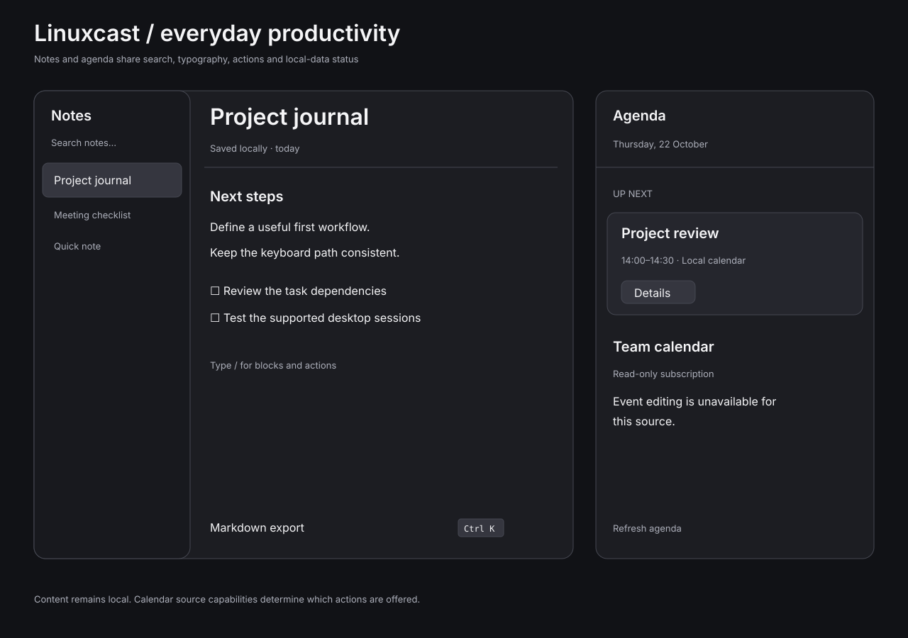
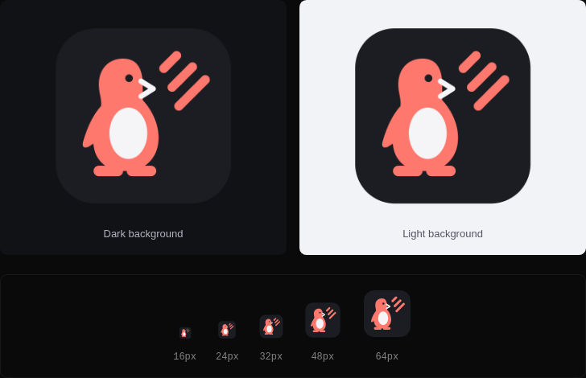

# Design examples and provenance

These are **original Linuxcast planning mockups**, created 22 October 2026 with the deterministic [render script](../../../scripts/render_design.py). They illustrate intended design; they are not screenshots of an implemented application and are not copied Raycast assets. Linuxcast-authored SVGs are GPL-3.0-only.












## Project icon


The approved project icon combines a coral penguin, a command-prompt-shaped beak and three diagonal casting rays. The penguin refers to Linux; the rays play on “cast” and the sense of motion in [Raycast's branding](https://www.raycast.com/). Its geometry is original Linuxcast artwork. It uses the existing graphite, coral and text colours from [tokens.json](../tokens.json). The rounded tile has transparent outer corners and retains the same appearance on dark and light backgrounds.

Created 31 October 2026 as original, hand-authored SVG artwork; GPL-3.0-only. The [SVG source](linuxcast-project-icon.svg) scales without loss, and the [1024 px PNG](linuxcast-project-icon.png) is available for project avatars. No third-party artwork, fonts, embedded images or external resources are included. This is project artwork, not evidence of installed desktop integration.



The preview above is a static artwork review showing dark/light backgrounds and 16, 24, 32, 48 and 64 px samples. It is not an application screenshot.

The project icon is maintained directly in its SVG source; `render_design.py` regenerates the six planning examples only. Regenerate the PNG using ImageMagick 6:

```sh
convert -background none docs/design/assets/linuxcast-project-icon.svg docs/design/assets/linuxcast-project-icon.png
```

## Source observations

The research inspected the [Raycast website](https://www.raycast.com/), launcher, emoji grid and chat imagery in [New in v2](https://manual.raycast.com/new-in-v2), and the [technical design discussion](https://www.raycast.com/blog/a-technical-deep-dive-into-the-new-raycast). The [Alfred workflow page](https://www.alfredapp.com/workflows/) and [editor documentation](https://www.alfredapp.com/help/workflows/getting-started/editor-and-palette/) establish interaction references for workflow editing. The original reference images remain on their owners' sites; none is distributed as a Linuxcast icon or product asset.

Observed traits and original proposed measurements are separated in [DESIGN.md](../DESIGN.md). SVG illustration coordinates are explanatory compositions rather than an alternate token source. Implementation derives actual dimensions from [tokens.json](../tokens.json).

Regenerate originals with `python3 scripts/render_design.py`. Validate with `python3 scripts/validate_plan.py`. Preview them in a browser before accepting changes. During application implementation, add genuine light/dark state screenshots to PRs; do not substitute these illustrations for runtime evidence.
